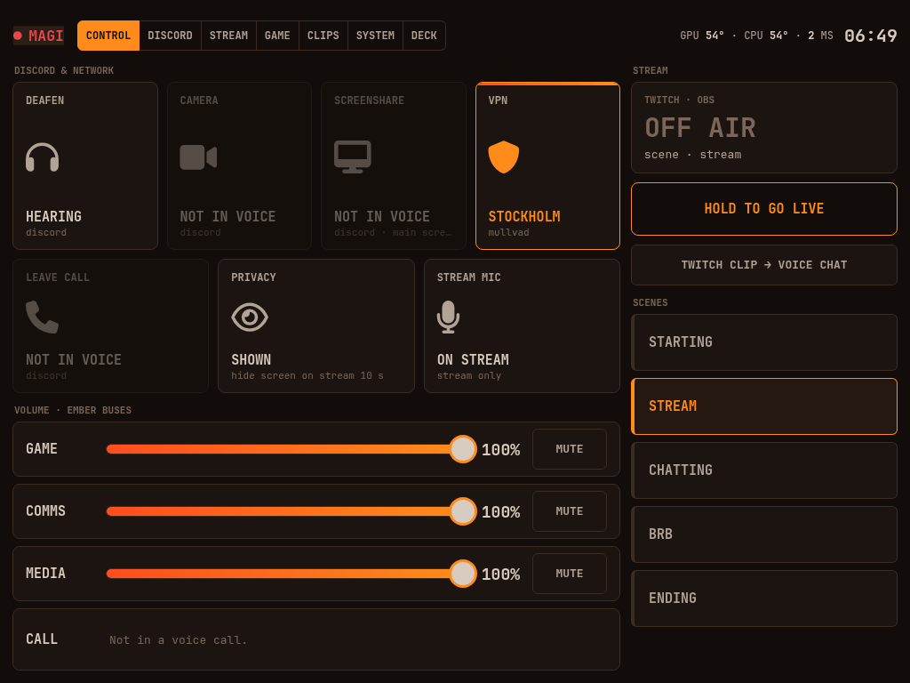

# ember-pad

[](https://github.com/Tjabooo/ember-pad/actions/workflows/ci.yml) [](https://github.com/Tjabooo/ember-pad/releases) [](LICENSE)

A LAN touch deck for an old tablet next to your desk: Discord, OBS scenes, audio buses, clips and a CS2 bomb timer, served by one small Rust binary to a page that still runs on an iPad mini with iOS 9.



Most people put a Stream Deck there. This puts a cracked iPad there instead: an always-on page in Safari (Add to Home Screen + Guided Access), driven by a user service on a Hyprland desktop. It is the deck for the EMBER/MAGI desktop tools, so several tiles call those tools; anything it can't reach is shown greyed out instead of breaking the page.

## Features

- **CONTROL**: Discord deafen / camera / screenshare / leave call, VPN, stream privacy and stream mic, audio bus sliders, a call row with every person's avatar (per-person volume 0-200 %, local mute, soundboard mute).
- **DISCORD**: hop between voice channels, people in your channel with local volume, soundboard, online status and custom status quick picks.
- **STREAM**: stream health, hold-to-go-live / end, OBS scene buttons, Twitch clip straight into the voice chat (through [magi-overlay](https://github.com/Tjabooo/magi-overlay)).
- **GAME**: CS2 card (score, round, bomb), Leetify stats, live performance from the MangoHud CSV log.
- **CLIPS**: recent clips with thumbnails: keep, trash, or SEND (uploads a share copy into the voice channel's text chat).
- **SYSTEM**: volume and mute per PipeWire bus. **DECK**: your own buttons from a `deck.toml`.
- **Overlays**: a full-screen CS2 bomb timer (exact, from its own game state integration feed), a match-found flash, and an idle clock with the current song when you're away.
- Live state without polling forks: a long-running `pactl subscribe` watcher, state files, and one long poll for the bomb timer.

## Install

Needs Rust 1.85+, PipeWire (`pactl`) and Hyprland (`hyprctl`) on the desktop.

```sh
git clone https://github.com/Tjabooo/ember-pad && cd ember-pad
./install.sh                                  # builds, installs ~/.local/bin/ember-pad, adds the user unit
systemctl --user enable --now ember-pad
ember-pad url                                 # open this address on the tablet
```

If a firewall runs on the desktop, allow the tablet only, for example `sudo ufw allow from <tablet-ip> to any port 7790 proto tcp`.

On the tablet: open the URL, Share → Add to Home Screen, then start it from the home screen (full screen, no browser bars). Guided Access and Auto-Lock off keep it on the deck.

## Usage

```
ember-pad [serve]   run the HTTP server (what the service does)
ember-pad url       print the tablet URL, including the access key
```

Discord tiles need Discord started with `--remote-debugging-port=9223` (bound to loopback). Without it they show "discord offline".

For the exact bomb timer, add a CS2 game state integration file (`csgo/cfg/gamestate_integration_ember_pad.cfg`) that posts to `http://127.0.0.1:7790/gsi` with `buffer 0`, `throttle 0` and your pad key as the auth token, then restart CS2.

## Configuration

`~/.config/ember/pad.toml`, every key optional. See [`pad.example.toml`](pad.example.toml):

| Key | Default | What |
| --- | --- | --- |
| `bind` | `0.0.0.0:7790` | listen address |
| `discord_port` | `9223` | Discord's DevTools port |
| `overlay` | `127.0.0.1:7788` | magi-overlay (OBS, stream health, CS2) |
| `scenes` | 5 names | OBS scene buttons |
| `share_screen` / `side_screen` | first / second monitor | Hyprland outputs for Go Live |
| `mic` | `@DEFAULT_SOURCE@` | the source the mic state follows |
| `custom_statuses` | 3 lines | custom status quick picks |

The access key lives in `~/.config/ember/pad.key` (created with mode 0600 on first start). The DECK tab reads `[[action]]` entries (`label`, `run`) from `~/.config/ember/deck.toml`.

Tiles that call other tools: `ember` (mic, mix, mode), `ember-vpn`, `ember-clip` / `clip-save` (clips), `wlopm`, `grim`, `wl-copy`, Mullvad. The audio bus sliders expect PipeWire sinks named `ember_game`, `ember_comms`, `ember_media` and `ember_fx`.

## How it works

- One thread-per-connection HTTP server (std only). Every route needs the key (query `k`, header `X-Pad-Key` or the `pad` cookie) and a private-network peer address.
- `GET /api/state` returns everything the page shows; the page polls it about once a second and keeps an NTP-style clock offset from the fastest round trip, so the bomb timer counts down in the desktop's time.
- Discord is driven over the Chromium DevTools protocol: `discord.js` is injected into the client and clicks the same buttons you would (by aria label), reads voice state from Discord's own stores, and uploads clips through a hidden file input.
- The page is ES5 with no `fetch`, grid or arrow functions, because Safari 9 is the target.

## License

MIT
